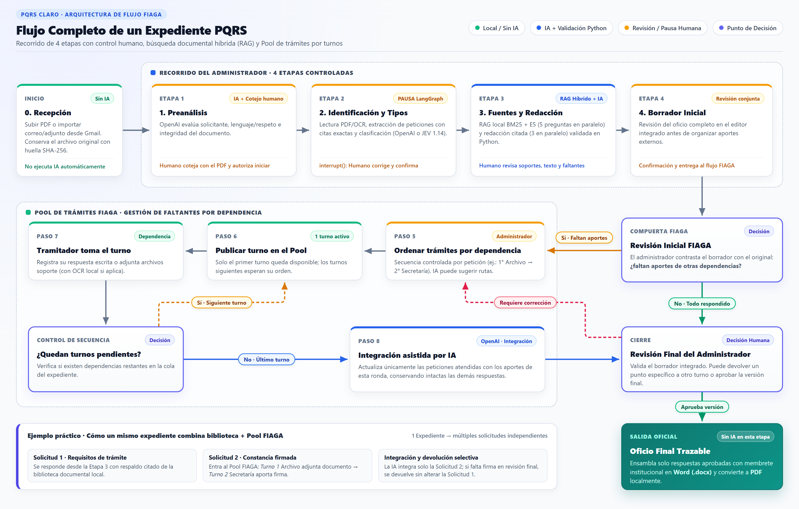

# Gestión de Peticiones · PQRS Claro

Asistente local para recibir documentos PQRS, identificar y clasificar sus peticiones,
buscar respaldo documental y preparar respuestas y oficios con revisión humana.

La interfaz y la API se sirven juntas en **http://127.0.0.1:8772**.
En FIAGA, cada PQRS pasa del preanálisis a la preparación de un primer borrador. El administrador revisa
las respuestas y organiza los aportes que necesita de otras dependencias.

## Empezar en otro equipo

Necesitas Windows, PowerShell, [uv](https://docs.astral.sh/uv/) y Python 3.12.
Microsoft Word de escritorio es necesario para convertir el oficio a PDF.
Node.js se utiliza únicamente para las pruebas JavaScript.

```powershell
git clone https://github.com/JorgeMountain/pqrs-claro.git
Set-Location pqrs-claro
uv python install 3.12
.\scripts\setup.ps1
Copy-Item .env.example .env.local
```

Edita `.env.local` con una clave OpenAI propia y autorizada; después inicia:

```powershell
.\scripts\start.ps1
```

Abre **http://127.0.0.1:8772** con el perfil **Administrador**. Desde **Recepción**
puedes revisar un PDF de `examples/` antes de enviarlo o abrir **Correo electrónico**
para elegir el adjunto o el cuerpo de un mensaje de Gmail. Ambos canales abren un expediente.
Una instalación nueva empieza con la biblioteca vacía. La búsqueda usa las fuentes
disponibles para el expediente. Las llamadas de IA utilizan el proveedor configurado.

**Guía completa:** [instalación, configuración y transferencia](docs/ENTREGA.md).
**Para desarrollar:** [CONTRIBUTING.md](CONTRIBUTING.md).
**Todas las guías:** [índice de documentación](docs/README.md).

## Flujo de trabajo



> Para ver también los diagramas de **arquitectura/framework (Local vs. Nube)**, **mapa híbrido de IAs** y los **6 grafos LangGraph**, consulta [docs/GUIA_VISUAL_PQRS_CLARO.md](docs/GUIA_VISUAL_PQRS_CLARO.md).

| Etapa | Resultado |
| --- | --- |
| 1. Preanálisis | El administrador coteja el solicitante, el lenguaje y la legibilidad con el PDF, documenta las alertas y confirma cuándo iniciar la identificación. |
| 2. Identificación de peticiones | Contrasta cada petición con su fragmento del original, puede corregirla o descartarla y revisa el tipo y la ruta antes de iniciar la redacción. |
| 3. Fuentes y redacción | Revisa las fuentes y las respuestas, guarda sus correcciones y confirma la lectura conjunta. Un soporte pendiente puede enviarse después a la dependencia responsable. |
| 4. Borrador | Revisa el oficio completo en el editor y confirma su entrega a FIAGA para organizar los faltantes. |
| Revisión inicial | El administrador contrasta el borrador con el original, puede corregir una respuesta con su motivo y ordenar los trámites pendientes. Si todo está respondido, pasa directamente a revisión final. |
| Pool de trámites | El primer turno queda disponible y los posteriores esperan. Quien lo toma registra su respuesta o adjunta archivos. El administrador puede dejar el turno abierto o reservarlo para un tramitador. |
| Integración y revisión final | Al completar la secuencia, la IA actualiza las peticiones atendidas con los aportes de esa ronda. El administrador puede pedir una corrección en otro turno o aprobar la versión y descargarla en Word. |

Por ejemplo, si una solicitud pide los requisitos de un trámite y una constancia
firmada, el borrador puede responder los requisitos con la biblioteca. Para la
constancia, el administrador puede pedir primero el documento a Archivo y después la
firma a Secretaría. Si falta una firma en la revisión final, devuelve ese punto y
conserva la respuesta sobre requisitos y los aportes anteriores.

En **Expedientes** se puede consultar el documento recibido, sus peticiones, el
borrador, los trámites y la decisión. Durante el procesamiento se muestra el avance
de la lectura, la identificación, la búsqueda de fuentes y la redacción.
**Pool de trámites** reúne los turnos disponibles. **Mi trabajo** reúne los turnos
que ya tomó el tramitador activo.

Los expedientes de la versión automática que quedaron en preparación o revisión inicial
ofrecen **Revisar las cuatro etapas**. Esta acción abre el recorrido del administrador
y conserva el borrador anterior para compararlo. Los casos que ya tienen trámites
continúan desde su turno o decisión guardados.

Los perfiles son identidades locales del prototipo. **Recursos → Expedientes anteriores** abre
la gestión histórica, incluidos sus oficios, tiempos de gestión y registros de avance.

**Solicitudes recientes** permite retomar un expediente desde Recepción. Dentro del editor,
la fase **Recepción** en **Ruta del expediente** vuelve a la ficha de esa misma solicitud.
La pestaña **Recepción** del menú superior abre la bandeja general.

## Estructura

```text
src/pqrs_claro/             API, servicios, grafos, motores y persistencia
  static/recorrido/         Interfaz principal en HTML, CSS y JavaScript
  static/demo/              Recursos mínimos para arrancar una copia limpia
tests/                      Pruebas Python y JavaScript
scripts/                    Instalación, arranque y validaciones
examples/                   Peticiones y fuentes ficticias para practicar
docs/                       Guías funcionales, arquitectura e informes fechados
pyproject.toml + uv.lock     Dependencias y versiones resueltas
.env.example                Plantilla sin claves
```

En `static/recorrido/` conviven la recepción (`fiaga.html`) y el editor de cuatro
etapas (`index.html`). «Expedientes anteriores» también carga `index.html`. El modo de
arranque alternativo abre `static/workspace/`, que enlaza a `/anterior` para consultar
el expediente en la interfaz previa. El laboratorio `static/laya-lab/` se abre con
`scripts/start-laya-lab.ps1`.

`data/`, `output/`, `tmp/`, `.runtime/`, `.venv/` y los archivos `.env` locales
permanecen fuera de Git. La clonación entrega código y ejemplos ficticios; los
expedientes y la biblioteca se transfieren por separado cuando corresponda.

Para seguir el código: [guía para colaborar](docs/GUIA_PARA_ENTENDER_Y_COLABORAR.md)
y [arquitectura con diagramas](docs/GUIA_VISUAL_PQRS_CLARO.md).

## Configuración y datos

- OpenAI procesa la extracción/interpretación, evidencia y redacción con `store=False`.
  El contenido necesario se transmite al proveedor configurado.
- El clasificador de tipos admite `openai` o `jev`. La plantilla usa `openai` para
  comenzar con una sola credencial; [JEV](docs/JEV_CLASIFICACION.md) es opcional y usa
  una clave TypeSafe propia. La configuración local existente se conserva.
- La búsqueda combina texto, identificadores, contexto y embeddings locales.
  El [modelo semántico](docs/busqueda-semantica-local.md) se descarga explícitamente.
  Mientras falta o se prepara, los otros canales siguen disponibles y se informa su alcance.
- El lector de fuentes usa Fast por defecto en todos los expedientes. Para volver al
  modo habitual, pon `PQRS_CLARO_SOURCE_SERVICE_TIER=default` en `.env.local` y
  reinicia la aplicación. Para reactivar Fast, cambia el valor a `fast`.
- El buscador atiende un expediente por turno y, por defecto, busca respaldos para
  **hasta cinco preguntas de ese expediente a la vez**. Puedes elegir un límite
  de 1 a 5. Para volver a tres, pon `PQRS_CLARO_SOURCE_CONCURRENCY=3` en
  `.env.local` y reinicia la aplicación. La redacción tiene su propio límite en
  `PQRS_CLARO_DRAFT_CONCURRENCY`, con tres por defecto. El entorno del proceso
  tiene prioridad sobre `.env.local`. Puedes comprobar los límites activos en
  los campos `source_concurrency` y `draft_concurrency` de `GET /api/config`.
- [Gmail](docs/GMAIL.md) requiere una conexión propia; no se transfieren tokens.
- Los originales, decisiones, respuestas, aprobaciones y checkpoints se guardan en
  SQLite y archivos de `data/`. Cambiar únicamente el puerto no aísla los datos.

El sistema escucha en `127.0.0.1` y se opera como aplicación local. La integración
con QFDocument/Oracle y el despliegue institucional multiusuario requieren trabajo
adicional. Una fuente encontrada no certifica por sí sola un hecho ni sustituye la
revisión humana. Consulta [recuperación](docs/RECUPERACION.md) y
[suficiencia](docs/SUFICIENCIA.md).

## Comprobar los cambios

GitHub Actions verifica cada PR dirigido a `master` desde una copia limpia de Windows.
Arranca FIAGA con una bandeja temporal, comprueba la portada y la API, ejecuta Ruff
y pytest con el modelo semántico público e incluye las pruebas de JavaScript,
aprobación del oficio y recorridos en Chrome. Los resultados aparecen en la pestaña
`Checks` del PR.

En Windows, `scripts/test.ps1` sin argumentos ejecuta Ruff, pytest, JavaScript y los
recorridos en Google Chrome. `scripts/setup.ps1` instala las dependencias de Playwright.
Chrome debe estar instalado en el equipo.

```powershell
.\scripts\test.ps1
```

Para repetir solo el arranque y los recorridos de navegador con el entorno de GitHub Actions:

```powershell
uv sync --locked --python 3.12 --group browser
uv run --no-sync python scripts/check-fiaga-startup.py
uv run --no-sync python -m pytest -q -o 'python_files=check_*_browser.py' tests
```

Las pruebas automáticas utilizan datos temporales y dobles de IA/conversión.
Los scripts `check_*live.py` son validaciones distintas que pueden invocar servicios
reales. Los informes anteriores en `docs/` registran su propia fecha y alcance;
no equivalen a una nueva ejecución ni a una validación institucional.
