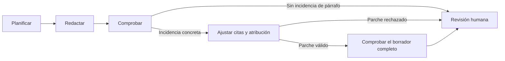

# Calidad de los borradores y precisión de las citas

El borrador debe responder con los pasajes que realmente sostienen cada afirmación.
La fecha o la persona mencionadas en una pregunta no son hechos comprobados. Decir
que un antecedente no permite afirmar algo tampoco equivale a afirmarlo.

## Cómo se comprueba

Los controles locales distinguen afirmaciones, preguntas y límites por cláusulas.
Detectan señales claras, como un año afirmado sin respaldo, una expedición atribuida
a un borrador o una entrega presentada como ejecutada. La negación de una cláusula
no autoriza una afirmación diferente en la siguiente. Los casos semánticos ambiguos
siguen sometidos al contraste con IA y a la revisión humana.

El contexto de citas conserva el título y la versión de cada documento, separa los
años mencionados en el pasaje de los años consultados y muestra vecinos que ya están
entre las fuentes seleccionadas. Esto ayuda a incluir el pasaje que explica «ese
semestre» sin incorporar candidatos que aún no son citables. Coincidir en el número
del oficio relaciona archivos PDF/DOCX; no demuestra equivalencia de contenido.

## Un ajuste acotado dentro de LangGraph

El ajuste ocurre una sola vez durante la generación de un borrador nuevo. Solo puede
cambiar el texto y las citas de los párrafos señalados; no agrega párrafos, fuentes,
hechos, pendientes o resoluciones. Si la observación no justifica una corrección,
puede conservar el párrafo. El resultado conserva `repair.before_draft`,
`repair.before_checks`, los índices afectados y si hubo cambios. La nueva comprobación
puede seguir señalando errores; el ajuste nunca aprueba la respuesta.

Si un parche recibido intenta usar una cita vacía o desconocida, alterar otro párrafo
o retirar contenido no autorizado, se rechaza entero y se conserva el borrador con
sus comprobaciones anteriores. La incidencia queda visible como
`citation_repair_rejected` y en `repair.status/reason`. Ese rechazo no pierde la
pregunta ni bloquea la preparación del resto: termina con ajustes pendientes, sin
reintentar el parche ni volver a gastar una llamada para comprobar un texto intacto.
Los errores del proveedor, de lectura o de cambios en las fuentes siguen siendo
errores recuperables; no se convierten en un parche rechazado ni se ocultan.

Hay una excepción de retirada, limitada a un párrafo que solo repite la solicitud
actual: debe estar señalado como `request_scope_only` y pasar una validación local
independiente de todo su texto. Su alcance permanece en la pregunta y el plan. No se
retiran párrafos con hechos, antecedentes o límites sustantivos por tener una cita
insuficiente. `repair.removed_request_scope_indices` conserva los índices anteriores
al ajuste para reconstruir lo retirado y cotejar los párrafos restantes.

Los pasos se guardan en checkpoints. Una interrupción durante la segunda comprobación
permite reanudarla sin volver a planificar, redactar o ajustar las citas. Las huellas
incluyen las versiones de generación y revisión: resultados calculados con reglas
anteriores no se presentan como evaluaciones vigentes de las reglas nuevas.

El evaluador distingue los metadatos conservados por Python (`check_key`, enlaces y
versiones de los pendientes) de las citas escritas en los párrafos. Un identificador
interno no es una cita inventada. Del mismo modo, un punto del plan que delimita lo
pedido no afirma que un antecedente pruebe ese hecho o que la actuación ya se ejecutó.

La revisión humana permanece separada. Su texto guardado no pasa por el ajuste
automático. Una evaluación de contenido correcta tampoco cierra una comprobación
abierta: Python conserva ese bloqueo. El modelo señala defectos adicionales de
contenido o resolución, evitando repetir la mera existencia de los controles abiertos.

## Validación reproducible

`scripts/validate_draft_quality.py` conserva la prueba anterior y crea otra copia en
`output/qa/draft-quality-20260909`. Compara controles locales sobre los mismos textos,
comprueba con IA los siete borradores anteriores que pasaban y genera nuevamente las
23 respuestas con sus fuentes v11 conservadas. Guarda llamadas, consumo de tokens,
texto anterior y posterior a cada ajuste, y compara los pendientes por clave y alcance.

Los informes de lectura documental se guardan por separado de los estados de aprobación.
Ni las pruebas ni la IA crean comprobaciones institucionales, firmas o envíos. Las
huellas de las bases vivas y de la prueba anterior se verifican al cerrar la ejecución.
