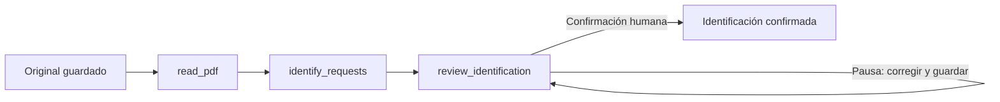

# Cómo funciona PQRS Claro

## Recorrido de un PDF

1. **Cargar.** FastAPI recibe el archivo, comprueba su formato y límites y conserva el original con una huella de integridad. Se crea un expediente.
2. **Leer.** El primer nodo de LangGraph extrae el texto por página. Si necesita OCR, envía la imagen de esa página a OpenAI y marca la transcripción para revisión.
3. **Identificar.** El segundo nodo entrega a OpenAI las páginas y sus líneas numeradas. El modelo propone solicitudes y elige rangos de líneas. Python recupera esas líneas originales, asigna identificadores y comprueba la estructura.
4. **Revisar.** El tercer nodo se detiene con `interrupt`. Puedes ver las páginas, corregir títulos o descripciones, incorporar omisiones y ajustar referencias. Guardar conserva una versión del expediente.
5. **Confirmar.** La aplicación entrega a LangGraph la identificación guardada mediante `Command(resume=...)`. El nodo comprueba su formato y referencias, y termina este primer hito.

## Quién hace qué

| Componente | Responsabilidad | Ejemplo |
|---|---|---|
| Python | Operaciones y validaciones comprobables | Recuperar exactamente las líneas 8 a 10 de la página 2 |
| IA | Interpretación del texto y transcripción de imágenes | Reconocer que pedir una copia constituye una solicitud |
| LangGraph | Orden, checkpoints y pausa | Reanudar después de que la persona confirme |
| Persona | Contrastar el resultado | Detectar una solicitud omitida o un OCR equivocado |

La pantalla **Ver proceso** muestra entradas, etapas y resultados. No representa el razonamiento privado del modelo.

## Los archivos, uno por uno

Los módulos se encuentran en `src/pqrs_claro/`.

| Archivo | Qué contiene |
|---|---|
| `config.py` | Rutas, límites, modelo y lectura de la clave autorizada; no escribe secretos |
| `models.py` | Forma de una página, solicitud y cita; reglas que impiden referencias o relaciones inválidas |
| `extraction.py` | Lectura PDF y OCR por página |
| `identification.py` | Instrucción de identificación, llamada estructurada y construcción de citas originales |
| `workflow.py` | Los tres nodos y sus conexiones; el estado que necesitan para continuar |
| `storage.py` | Expedientes, originales, historial y versiones en SQLite |
| `service.py` | Inicia o recupera el grafo y lleva sus resultados al expediente visible |
| `app.py` | Rutas web de carga, consulta, imágenes, corrección y confirmación |
| `source_library.py` | Catálogo de fuentes, originales, versiones, revisión atribuida y referencias de texto |
| `source_service.py` | Conecta la biblioteca y el grafo de fuentes con el expediente visible; controla actualización y recuperación |
| `source_api.py` | Rutas web para incorporar y consultar fuentes y ejecutar la búsqueda por solicitud |
| `source_retrieval.py` | Búsqueda textual BM25 de fragmentos, con restricciones por categoría y ámbito del caso |
| `source_assessment.py` | Evaluación de pertinencia y faltantes con IA, con validación de las referencias recuperadas |
| `source_graph.py` | Coordina la recuperación y evaluación de cada solicitud, y conserva su avance |
| `static/` | La pantalla, su diseño y las acciones del navegador |
| `__init__.py` | Identifica el paquete Python |

Los scripts preparan dependencias, inician la aplicación y ejecutan comprobaciones. Los tests usan dobles explícitos para aislar reglas; `check_live.py` hace llamadas reales con ejemplos ficticios.

## Expediente y checkpoint

**Expediente:** el original, texto, identificación editable, versiones, eventos y confirmación. Permite consultar qué se guardó y qué cambió.

**Checkpoint:** la fotografía interna del avance de LangGraph. Permite continuar después de un fallo o una pausa. No reemplaza el historial del expediente.

Durante la revisión, la versión editable vive en el expediente. Al confirmar, esa versión pasa al nodo de revisión. Recuperar una pausa debe conservar la corrección humana, incluso cuando el checkpoint aún contenga la propuesta anterior.

## Fechas y OCR

**Fecha del documento** procede de su texto. **Carga** registra cuándo se guardó el archivo. **Recepción** necesita evidencia propia y queda sin registrar en esta entrega. Estas fechas tienen significados diferentes.

Las citas de una página nativa se verifican contra el texto extraído. En una página escaneada, se verifican contra la transcripción OCR; también debes contrastarlas con la imagen original, disponible en la pantalla.

## Un ejercicio de cinco minutos

Abre el ejemplo ficticio, selecciona la solicitud de copia del acta y mira la página 2. Comprueba que la descripción conserva el pedido de copia completa. Edita su título, guarda y recarga la página. Verifica que la corrección permanece. Confirma la identificación: el expediente queda listo para buscar fuentes.

## Qué sucede después: fase 4

La biblioteca conserva cada documento y las versiones incorporadas. Sus datos indican qué es, de dónde proviene, para qué expediente sirve y quién lo revisó. Un PDF conserva referencias de página; un TXT o DOCX conserva ubicaciones del texto extraído, sin atribuirle páginas que no se verificaron.

Para cada solicitud, `source_retrieval.py` busca fragmentos por sus palabras mediante BM25. `source_assessment.py` entrega esos candidatos a la IA para valorar pertinencia y faltantes; las referencias se comprueban contra el texto conservado. `source_graph.py` conecta esas operaciones y guarda el avance. `source_service.py` relaciona el resultado con las versiones de la biblioteca y la solicitud utilizadas, y `source_api.py` lo hace accesible desde la interfaz.

Por ejemplo, las reglas ficticias permiten localizar el procedimiento y requisitos de Aula Abierta. El registro de EJEMPLO-042 aporta recepción y estado a una fecha de corte. Ninguno contiene la copia del acta: la tercera solicitud conserva ese faltante.

La persona puede abrir el original y contrastar el fragmento. Las referencias de estilo se mantienen separadas de las respuestas históricas: estas últimas permiten recuperar contenido anterior atribuido y relacionarlo con sus anexos cuando se vincula la colección al expediente. Ninguna coincidencia textual certifica vigencia, suficiencia o aplicabilidad. [HISTORICOS.md](HISTORICOS.md) explica el nuevo recorrido.

Si se incorpora otra versión de una fuente, el resultado anterior conserva su referencia y debe actualizarse para reflejar la nueva biblioteca. La identificación confirmada mantiene su hito propio. Este recorrido todavía no redacta respuestas ni genera oficios.

Lee el ejercicio completo y sus criterios en [FASE4.md](FASE4.md), y la decisión sobre biblioteca local y Drive en [ALMACENAMIENTO.md](ALMACENAMIENTO.md).
