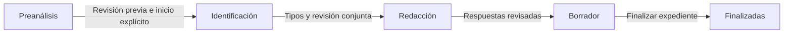

# Instalar y recibir el proyecto

Guía de incorporación revisada el 26 de octubre de 2026. Describe la aplicación
local actual y la entrega del código. Los informes de ensayos anteriores conservan
su fecha, datos y límites.

## 1. Descargar e instalar

En Windows, instala PowerShell y `uv`. Python 3.12 puede instalarse mediante uv:

```powershell
git clone https://github.com/JorgeMountain/pqrs-claro.git
Set-Location pqrs-claro
uv python install 3.12
.\scripts\setup.ps1
Copy-Item .env.example .env.local
```

El instalador carga las dependencias en `.runtime/` y prepara la inicialización
de pywin32. No hace falta copiar `.venv/` ni las dependencias del equipo anterior.
Word de escritorio se necesita para convertir el oficio a PDF. Node.js se requiere
para ejecutar las pruebas `.mjs`; la aplicación no necesita un servidor npm.

## 2. Configurar credenciales propias

Edita `.env.local` e introduce `OPENAI_API_KEY`. La plantilla nunca contiene una
clave utilizable. También puedes indicar un archivo autorizado mediante
`PQRS_CLARO_KEY_FILE`, o utilizar una variable de entorno. El código conserva una
búsqueda histórica en `../langgraph-pqrs/.env.local`, pero una instalación nueva
debe configurar su propia clave y no necesita ese proyecto hermano.

La plantilla propone `PQRS_CLARO_CLASSIFICATION_PROVIDER=openai`. Si el equipo
va a usar JEV para clasificar tipos, cambia el valor a `jev`, configura
`PQRS_CLARO_JEV_KEY_FILE=.env.jev.local` y guarda `TYPESAFE_API_KEY` en ese archivo.
El resto del flujo conserva el modelo OpenAI configurado. Consulta
[JEV_CLASIFICACION.md](JEV_CLASIFICACION.md) para su alcance y errores.

Los archivos `.env`, `.env.local` y `.env.jev.local` están ignorados por Git.
Las conexiones de Gmail se configuran en cada instalación; sus tokens protegidos
no forman parte de la entrega del código.

## 3. Iniciar y comprobar

```powershell
.\scripts\start.ps1
```

Abre **http://127.0.0.1:8772**. El script mantiene el servidor en esa terminal.
Para comprobar que la interfaz y la API están disponibles:

```powershell
Invoke-RestMethod http://127.0.0.1:8772/recorrido-status
```

El resultado habitual incluye `interface=recorrido`, `mode=unified` y
`library=connected`. Esto indica que la biblioteca está conectada al servidor;
una biblioteca recién instalada puede estar vacía. `/api/config` muestra si los
proveedores están configurados, sin revelar las claves.

Un clon limpio incluye el snapshot vacío y el logo necesarios para abrir la
bandeja. Ya no depende de copiar `output/ux-peticiones-20260910/`. Si ese directorio
existe en una instalación anterior, conserva su demo local. Los ejemplos ficticios
para practicar están en `examples/`; sus fuentes están en `examples/sources/`.

No es necesario tener claves para ejecutar las pruebas automáticas. Las acciones
de análisis real sí requieren su proveedor y pueden consumir saldo. La búsqueda
semántica local se instala aparte mediante el comando documentado en
[busqueda-semantica-local.md](busqueda-semantica-local.md).

## 4. Recorrer las cuatro etapas



| Etapa | Módulos de entrada |
| --- | --- |
| Preanálisis | `preanalysis.py`, `preanalysis_engine.py`, `static/recorrido/preanalysis.js` |
| Identificación y tipos | `workflow.py`, `identification.py`, `petition_classification.py`, `jev_classification.py`, `intake_service.py` |
| Fuentes y redacción | `preparation.py`, `source_service.py`, `source_retrieval.py`, `source_semantic.py`, `draft_service.py` |
| Revisión y oficio | `review_service.py`, `office_workspace.py`, `office_service.py`, `static/recorrido/live-document.js` |
| Avance y bandeja | `saved_progress.py`, `management.py`, `storage.py`, `static/recorrido/inbox-navigation.js` |

La vista **Finalizadas** depende del cierre de gestión guardado. Generar Word/PDF
no finaliza automáticamente el expediente. Las etapas guardadas se pueden consultar
sin empezar nuevamente la identificación ni la redacción.

## 5. Código y datos se entregan por separado

El clon incluye código, recursos de interfaz y casos ficticios. No incluye:

- `data/`: expedientes, originales, biblioteca, índices, revisiones y conexiones.
- `.env*` locales: claves y configuración particular.
- `output/` y `tmp/`: exportaciones, pruebas y evidencia local.
- `.runtime/` y `.venv/`: dependencias instaladas en otro equipo.

Para colaborar con el código no hace falta migrar los expedientes existentes.
Si se acuerda una migración de datos autorizada, detener antes el proceso que escribe,
crear un respaldo completo de `data/` y restaurarlo en una copia separada. Copiar
solo una SQLite puede perder originales o revisiones relacionadas. Conservar el
respaldo original y verificar el resultado antes de operar sobre la copia.
Las credenciales y conexiones se configuran por separado en el equipo receptor.

Para practicar en el mismo equipo sin tocar los expedientes actuales:

```powershell
$env:PQRS_CLARO_DATA_DIR = Join-Path $PWD 'output/qa/incorporacion'
.\scripts\start.ps1 -Port 8782
```

El puerto y el directorio de datos cumplen funciones distintas: cambiar el puerto
por sí solo no crea un entorno aislado. No guardar la base activa en una carpeta
sincronizada. La selección de gestor no aporta autenticación de usuarios.

## 6. Primer aporte sugerido

Lee [CONTRIBUTING.md](../CONTRIBUTING.md), ejecuta las pruebas y sigue una pantalla
hasta su ruta API y su servicio. El [índice de documentación](README.md) separa las
guías de trabajo de los planes e informes históricos. El proyecto todavía requiere
trabajo adicional para integración institucional y operación multiusuario.
