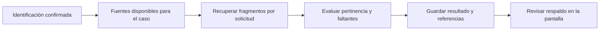

# Fase 4: fuentes y evidencia por solicitud

## Resultado esperado

Después de confirmar la identificación, seleccionar una solicitud y comprobar **qué fuentes pueden respaldarla, dónde está el fragmento pertinente y qué falta**. Esta fase prepara evidencia; la redacción y aprobación de respuestas siguen en las fases 5 y 6.

## Recorrido

1. **Incorporar documentos.** Cargar un PDF, DOCX o TXT con título, categoría y procedencia. Las fuentes pueden ser generales o estar vinculadas a un expediente; los soportes de un caso deben quedar en ese caso.
2. **Conservar y leer.** Guardar el original, su versión y huella SHA-256. Extraer texto con una ubicación rastreable. En PDF se conserva la página; el OCR requiere contraste con la imagen. DOCX y TXT se ubican por bloques o líneas del texto extraído, sin inventar páginas de Word.
3. **Revisar la fuente.** Registrar quién revisó el documento y su observación. La vigencia y la pertinencia para el caso requieren una decisión consciente; la fecha de carga no certifica ninguna de ellas.
4. **Buscar por solicitud.** Python recupera fragmentos del conjunto de fuentes disponible para ese expediente. Una coincidencia de palabras solo indica que merece revisión.
5. **Evaluar el respaldo.** La IA examina candidatos para esa solicitud, señala pertinencia, límites y faltantes. Python comprueba las referencias contra los fragmentos recuperados y aplica las restricciones de uso de las fuentes.
6. **Consultar y actualizar.** Mostrar resultados, fuentes y pendientes. Si cambia la biblioteca o la solicitud usada para la búsqueda, el resultado requiere actualización; se conserva la evaluación anterior para trazabilidad.

## Categorías y uso

| Categoría | Puede aportar | Comprobación necesaria |
|---|---|---|
| Norma nacional | Reglas generales aplicables | Procedencia, vigencia y aplicación al caso |
| Norma institucional | Reglas de la institución | Autoridad de la fuente, versión, vigencia y ámbito |
| Evidencia del caso | Hechos de ese expediente | Identificación del caso, fecha de corte y responsable |
| Oficio anterior | Estructura y estilo de una comunicación | Sus hechos y afirmaciones no se trasladan al caso actual |

Los documentos nuevos comienzan pendientes de revisión. La condición de revisado registra una declaración atribuida, no una verificación jurídica automática. Una norma cuya vigencia falta por verificar debe seguir mostrando esa limitación.

## Búsqueda inicial y papel de la IA

La recuperación inicial usa **BM25**, una búsqueda textual que ordena fragmentos según las palabras de la solicitud y su presencia en la biblioteca. Esa puntuación no es un porcentaje de certeza ni una conclusión sobre suficiencia.

Luego la IA evalúa los fragmentos recuperados. Se separan así dos decisiones: encontrar candidatos y valorar qué pueden respaldar. El original y su referencia permanecen disponibles para la persona.

Esta versión no usa embeddings. Antes de añadir búsqueda por significado se debe medir qué fuentes relevantes omite la búsqueda textual y comparar la mejora en casos con una referencia humana. Si una búsqueda no encuentra un acta, el resultado es “no se encontró en las fuentes disponibles”; no prueba que el acta no exista.

## Un ejercicio con Aula Abierta

Todos los documentos de `examples/sources/` están marcados como ficticios. Las dos fuentes predeterminadas son las reglas de Aula Abierta y el registro del caso EJEMPLO-042. Se incorporan al ámbito del expediente de ejemplo para no mezclarse con una biblioteca real.

| Solicitud | Fuente esperada | Qué debe mostrar el sistema |
|---|---|---|
| P1. Procedimiento y requisitos | `norma_ficticia.txt` | Pasos del trámite y requisitos de la versión cargada |
| P2. Fecha de recepción y estado | `registro_ficticio.txt` | Recepción 2026-09-01 y estado “En revisión” al corte 2026-09-07 |
| P3. Copia completa del acta | No hay archivo del acta | Falta verificar su existencia y obtener la copia completa; el registro no la sustituye |

Los identificadores P1, P2 y P3 corresponden a la referencia del ejemplo; lo que se compara en una evaluación es el contenido de cada solicitud.

Hay dos documentos adicionales para pruebas específicas:

- `oficio_anterior_ficticio.txt`: menciona entrega de un acta en EJEMPLO-999. No puede respaldar una entrega en EJEMPLO-042 ni sustituir el acta.
- `norma_ficticia_v2.txt`: agrega un requisito. Debe incorporarse como nueva versión de la misma fuente para comprobar que se conserva la anterior y los resultados necesitan actualizarse.

`manifest.json` describe las categorías y los usos `default`, `style_test` y `version_test`. El responsable y la revisión de estas fuentes también son ficticios; esos valores no deben copiarse a documentos reales.

## Estado, persistencia y alcance

El grafo de fuentes trabaja después de la confirmación de solicitudes. Conserva una fotografía de las solicitudes y de la biblioteca utilizada, además del avance por solicitud. Un fallo debe permitir consultar el trabajo ya guardado y continuar desde el avance persistido.

Actualizar la búsqueda no reabre la identificación confirmada ni aprueba una respuesta. Los resultados desactualizados se distinguen de los vigentes. Las versiones anteriores permiten consultar lo que el sistema había evaluado sin presentarlo como el estado actual.

## Criterios de aceptación

1. Recuperar procedimiento y requisitos para P1 y los dos datos del registro para P2.
2. Mantener pendiente la copia del acta de P3.
3. Mostrar referencias que correspondan al texto conservado y al original correcto.
4. Conservar el ámbito de cada expediente y el uso de cada categoría.
5. Distinguir documentos revisados de documentos por revisar y reflejar la vigencia sin inferirla.
6. Conservar versiones y señalar los resultados que requieren actualización.
7. Guardar resultados parciales y mostrar fallos del proveedor como fallos, sin completar con datos simulados.
8. Permitir comprender los soportes y pendientes desde cada solicitud.

Estos son criterios de aceptación, no un registro de pruebas ejecutadas. La evidencia y las limitaciones de las verificaciones realizadas se registran en [VALIDACION.md](VALIDACION.md).

Para la decisión sobre alojamiento y futuras conexiones, consultar [ALMACENAMIENTO.md](ALMACENAMIENTO.md).
