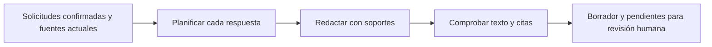

# Fase 5 · Preparar respuestas con soporte

Después de identificar y confirmar las solicitudes y actualizar su mapa de fuentes, la fase 5 prepara un borrador para cada una. El resultado muestra qué se propone responder, de dónde sale y qué sigue pendiente. La revisión humana de respuestas está disponible en la [fase 6](FASE6.md); la generación del oficio aprobado está disponible en la [fase 7](FASE7.md).

## Recorrido en la página

1. Abrir un expediente con identificación confirmada y consultar **4. Fuentes**.
2. Vincular los antecedentes pertinentes y completar o actualizar la búsqueda.
3. Entrar a **5. Borradores** y pulsar **Preparar borradores**.
4. Seguir el avance: preparar el plan, redactar y comprobar. Cada solicitud terminada aparece en la lista, aunque las siguientes continúen trabajando.
5. Seleccionar una solicitud. Los pendientes concretos aparecen antes del texto; se muestran los primeros y se pueden desplegar los restantes.
6. Leer el borrador y abrir las fuentes de cada párrafo. Los detalles permiten consultar el plan y las comprobaciones automáticas.
7. Pulsar **Continuar a revisión humana** para editar, resolver pendientes, comprobar y aprobar cada respuesta en **6. Revisar y aprobar**. Ese recorrido conserva su propio historial de versiones.

Un resultado **Para revisión humana** no está aprobado. **Con pendientes** identifica evidencia o comprobaciones por resolver. **Requiere ajustes** señala observaciones encontradas en el propio borrador. Los fallos de proveedor se muestran como errores y se pueden reintentar; los pendientes documentales no desaparecen por repetir una llamada.

## Qué ocurre detrás

**Python** comprueba que el expediente, el mapa y sus originales correspondan a la versión usada. Verifica el ámbito de las fuentes, las citas exactas y las referencias seleccionadas; registra los pendientes y rechaza identificadores inventados. Conserva los fragmentos originales, sin permitir que el modelo reescriba las citas.

**La IA** realiza tres tareas separadas: propone un plan que cubra los componentes de la solicitud; redacta párrafos vinculados a soportes; y revisa de forma crítica su respaldo, atribución, periodo y cobertura. Una comprobación automática satisfactoria sigue siendo una propuesta pendiente de revisión humana.

**LangGraph** ejecuta los tres pasos con un checkpoint por solicitud y huella de entradas. Una interrupción conserva los pasos ya guardados; el reintento recupera el punto pendiente. El sistema no incorpora un bucle que regenere indefinidamente hasta obtener una aparente aprobación.

## Reutilización de antecedentes

Una respuesta histórica puede sustentar lo informado en ese trámite. El borrador debe atribuir su contenido y conservar la persona, el periodo y las condiciones que correspondan. La verificación previa informada por el usuario se conserva como tal; no obliga por sí sola a repetir toda la revisión anterior ni equivale a la aprobación de una respuesta nueva.

Los archivos candidatos que no se seleccionaron permanecen disponibles para cotejo. Su presencia permite distinguir un archivo localizado de uno aún no encontrado, pero no los convierte automáticamente en soportes citables por el borrador. El modelo puede señalar un contraste necesario; en la fase 6 la persona puede seleccionar expresamente un fragmento candidato y comprobar su pertinencia junto con la respuesta editada.

Un oficio que relata un hecho no sustituye una certificación pedida; una mención o correo no sustituye el anexo. La redacción no afirma adjuntos, entrega, firma, expedición o inexistencia a partir de la presencia o ausencia en la búsqueda. Los borradores documentales siguen identificados como borradores.

El archivo que contiene un texto y la persona que lo escribió también se distinguen: un correo reenviado puede incluir alegaciones del peticionario. La verificación previa del archivo no convierte esas alegaciones en conclusiones institucionales. Si los fragmentos no permiten establecer su autoría, debe quedar atribuida al texto aportado o pendiente de aclaración.

## Archivos y estados

| Módulo | Función |
|---|---|
| `draft_engine.py` | Contratos de plan, borrador y comprobaciones; llamadas estructuradas y controles locales |
| `draft_graph.py` | Orden de los tres pasos y checkpoints |
| `draft_service.py` | Entradas, ámbito, avance por solicitud, errores, reintentos e invalidación |
| `draft_store.py` | Historial de ejecuciones en SQLite |
| `draft_api.py` | Consulta y solicitud de preparación desde la página |
| `static/drafts.js` y `static/draft-view.js` | Estado de la pantalla, progreso, texto, pendientes y enlaces |

`data/borradores.sqlite` conserva el historial de ejecuciones; `data/draft_checkpoints.sqlite`, los avances del grafo. Ambas bases quedan fuera de Git. Los expedientes y fuentes mantienen sus bases actuales.

Si cambian la identificación, el mapa, las fuentes, sus revisiones o los originales utilizados, el borrador queda desactualizado y se conserva para trazabilidad. La preparación exige actualizar primero el mapa de fuentes. La comprobación de entradas también se realiza durante la ejecución.

## Alcance y comprobación

Esta fase no modifica la identificación confirmada ni aprueba, firma, envía o exporta respuestas. **5. Borradores** permite consultar la propuesta; la edición y aprobación se realizan en el recorrido disponible de [fase 6](FASE6.md). Las reglas locales detectan señales concretas, pero no sustituyen una evaluación semántica o institucional.

Las pruebas deben comprobar citas y ámbito, preservación de pendientes, diferencias de periodo, atribución de antecedentes, documentos pedidos, fallos por solicitud, recuperación y cambios de entrada. La validación real debe revisar además texto, plan y comprobaciones contra la fuente, distinguiendo las llamadas reales de los dobles de pruebas. El registro de lo efectivamente ejecutado está en [VALIDACION.md](VALIDACION.md).
