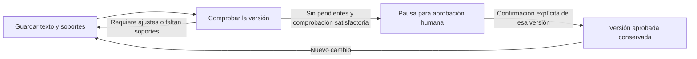

# Fase 6 · Revisar y aprobar cada respuesta

La fase 5 propone un borrador. En esta etapa una persona trabaja sobre él: corrige el texto, elige qué fragmentos lo respaldan, aporta datos que conoce, resuelve los pendientes y registra su aprobación de una versión concreta.

La aprobación prepara el contenido para generar el oficio en fase 7. No representa firma digital, envío ni entrega al peticionario.

## El recorrido

1. Abrir **5. Borradores** y continuar a **6. Revisar y aprobar**. Iniciar la revisión conserva una copia de cada respuesta y sus pendientes.
2. Elegir una solicitud. Leer primero **qué falta resolver** y contrastar sus soportes.
3. Editar los párrafos. Cada uno permite seleccionar fragmentos de documentos o aportes escritos y abrir su contenido original.
4. Resolver los pendientes con una explicación y el respaldo correspondiente. Si un pendiente no aplica, justificar por qué: por ejemplo, porque duplica otro punto ya atendido. Esa justificación también se evalúa.
5. Indicar quién guarda los cambios y pulsar **Guardar cambios**. Guardar no aprueba.
6. Pulsar **Comprobar esta versión**. El sistema contrasta el texto guardado con la solicitud, las fuentes, los aportes y las decisiones sobre pendientes. El resultado identifica ajustes concretos o habilita la aprobación.
7. Cuando no queden pendientes y la evaluación corresponda a la versión guardada, registrar quién aprueba y confirmar explícitamente que revisó la respuesta y sus soportes.

Se revisa una solicitud a la vez. El expediente solo queda preparado para el oficio cuando todas sus respuestas vigentes tienen una aprobación válida. El historial permite consultar las versiones y aprobaciones anteriores.

## Aportar un hecho sin adjuntar un archivo

La opción de aporte escrito conserva cuatro datos: **qué se afirma, quién lo conoce, cómo lo comprobó y en qué fecha**. El sistema añade la fecha de registro y una huella del contenido. La declaración se vincula únicamente a esa solicitud; no se transforma en una fuente general para cualquier expediente.

Ejemplo ficticio: la persona responsable de un registro confirma que EJEMPLO-042 sigue en revisión al 7 de septiembre de 2026 y explica que consultó el registro ese día. La respuesta puede citar ese aporte con su alcance y fecha. Si la petición exige una copia del acta, esa declaración no sustituye el archivo solicitado.

Para corregir una declaración, se retira el aporte activo y se agrega el nuevo. El anterior queda en el historial. Los párrafos que lo citaban se conservan para corregir sus referencias; retirarlo no borra el texto ni deja válida una aprobación anterior.

## Cómo se resuelven los pendientes

- **Abierto:** todavía requiere información o una decisión.
- **Resuelto con respaldo:** se explica la comprobación y se enlaza su fuente o aporte. Un pendiente documental requiere un documento citado.
- **No aplica:** se registra una explicación del alcance, la duplicidad u otra razón concreta. No elimina el pendiente del historial ni evita el contraste posterior.

El sistema conserva el texto de los pendientes originales. La persona decide cómo atenderlos; no puede desaparecer uno simplemente retirándolo del formulario. Una fuente localizada, una casilla marcada o una justificación escrita no prueban por sí solas que la petición esté respondida: la comprobación evalúa su relación con lo solicitado.

## Si aparecen fuentes nuevas

Agregar el archivo a la biblioteca del expediente, actualizar el mapa en **4. Fuentes** y sincronizar la revisión permite trabajar con ese respaldo. La sincronización conserva los párrafos editados, los aportes y las decisiones; incorpora los pendientes nuevos y exige una nueva comprobación.

Los candidatos del mapa pueden seleccionarse expresamente como citas durante la revisión. Se muestran como candidatos hasta que la persona los incorpora; su elección queda sometida al contraste de la respuesta. Los fragmentos conservan documento, versión, ubicación y texto original.

Las verificaciones históricas informadas por el usuario mantienen su atribución. La revisión comprueba cómo se aplica ese antecedente a la nueva pregunta, sin convertir las alegaciones reproducidas en un correo en conclusiones de la institución.

## Qué hace cada componente

**Python** valida versiones, referencias y ámbito; conserva declaraciones, resoluciones e historial; comprueba la integridad de originales y calcula las huellas. Rechaza la aprobación si la evaluación o las entradas cambiaron.

**La IA** comprueba el respaldo de las afirmaciones, la cobertura de la solicitud y las justificaciones sobre pendientes. No modifica el texto humano, no decide quién aprueba ni certifica la identidad del responsable.

**LangGraph** guarda la comprobación y se detiene antes de aprobar. La acción explícita de la persona reanuda esa pausa con la huella correspondiente. Un reinicio conserva la pausa; no debe obligar a repetir una comprobación válida.

**La persona** contrasta el contenido, aporta lo que conoce, decide cómo resolver los faltantes y asume la revisión de la versión que aprueba. En este piloto local los nombres son declaraciones registradas, no identidades autenticadas por un sistema institucional.

## Qué invalida una aprobación

Cambiar el texto, las citas, los aportes o las decisiones sobre pendientes exige volver a comprobar y aprobar. Lo mismo ocurre si cambian las solicitudes, las fuentes, sus versiones, sus revisiones, el ámbito consultado o el contenido de un original utilizado.

La aprobación anterior permanece en el historial con una copia de lo aprobado y sus huellas. Su existencia no permite usarla como aprobación del texto nuevo. Tampoco se aplica un resultado que terminó de calcularse después de que sus entradas cambiaran.

## Archivos y datos

| Archivo | Responsabilidad |
|---|---|
| `review_models.py` | Entradas permitidas para párrafos, aportes, resoluciones y aprobación |
| `review_engine.py` | Comprobaciones estructurales y evaluación semántica de la revisión |
| `review_graph.py` | Comprobación, pausa y reanudación para aprobar |
| `review_store.py` | Revisiones e historial persistentes |
| `review_service.py` | Sincronización, huellas, concurrencia, invalidación y aprobación |
| `review_api.py` | Acciones disponibles para la pantalla |
| `static/review*.js` | Edición, estados, pendientes, aportes e historial en el navegador |

`data/revisiones.sqlite` conserva el trabajo de revisión y sus versiones. `data/review_checkpoints.sqlite` guarda el avance de LangGraph. Ambas bases permanecen fuera de Git junto con los expedientes y documentos privados. GitHub conserva el código y la documentación, no una copia de esos datos.

La evidencia de las pruebas realizadas y sus límites se registra en [VALIDACION.md](VALIDACION.md). La etapa siguiente generará DOCX/PDF a partir de una versión aprobada, conservando la relación con sus soportes.
