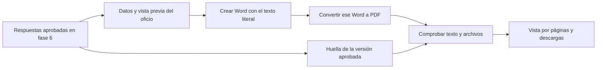

# Fase 7 · Generar el oficio desde lo aprobado

Esta fase convierte las respuestas revisadas en un oficio editable en Word y su copia en PDF. Toma la versión aprobada en la fase 6, conserva sus párrafos y fuentes, y permite preparar los anexos que se acompañarán al documento.

La generación no vuelve a consultar a la IA ni reescribe la respuesta. Tampoco firma, radica, envía o acredita la entrega del oficio.

## El recorrido en la página

1. Terminar **6. Revisar y aprobar**: todas las respuestas deben tener una aprobación vigente. Los cambios y aportes locales pendientes deben guardarse y pasar por la revisión correspondiente, o descartarse expresamente.
2. Pulsar **Continuar a generar oficio** o abrir **7. Generar oficio**. Si falta una aprobación, la pantalla indica qué solicitud requiere atención.
3. Completar **Institución**, ciudad, fecha del oficio, destinatario, asunto y nombre y cargo de quien suscribe. El asunto y destinatario identificados se proponen para revisar; la fecha se inicia con el día local del equipo y puede corregirse. La dependencia, el contacto y los números de oficio y petición son opcionales. Los nombres de quienes preparan y suscriben quedan vacíos para diligenciarlos.
4. Indicar quién prepara el documento y elegir los anexos que se incluirán. Solo se ofrecen originales citados por las respuestas aprobadas; no se adjunta automáticamente toda la biblioteca.
5. Pulsar **Preparar vista previa** y comprobar los datos, las respuestas, sus referencias y los anexos elegidos.
6. Pulsar **Generar Word y PDF**. El sistema crea el Word, lo convierte a PDF y comprueba el contenido antes de habilitar las descargas.
7. Revisar las páginas del PDF y descargar Word, PDF o el paquete con ambos archivos y los anexos seleccionados.

El nombre de quien aprobó una respuesta no se usa automáticamente como firmante. El formulario registra los datos del bloque de firma, pero no inserta una firma manuscrita o digital.

## Qué se conserva

Los párrafos aprobados aparecen en el orden de las solicitudes. Los títulos y descripciones permiten identificar a qué se responde. Cada párrafo lleva sus referencias humanas; la lista de fuentes distingue documentos y declaraciones atribuidas, con su ubicación o fecha de comprobación.

El oficio no incluye las discusiones internas sobre pendientes, los hallazgos del evaluador ni las notas de aprobación. La aplicación conserva esa trazabilidad y las huellas del contenido en el expediente local. Los nombres de archivos internos, rutas de este computador y códigos técnicos no se incorporan como citas del documento.

Los anexos mantienen los bytes del original conservado. El paquete usa nombres seguros y evita sobrescribir dos archivos con nombres iguales. Preparar ese paquete no demuestra que se haya entregado al peticionario.

## Qué ocurre si cambia algo

**Si cambian los datos del oficio**, se prepara una nueva vista previa y una nueva versión del documento. Esto no altera las respuestas aprobadas ni exige otra evaluación semántica por un cambio de ciudad, fecha o número de oficio. La versión guardada con los datos anteriores sigue identificada como tal y se puede descargar mientras sus respuestas y archivos permanezcan vigentes.

**Si cambia una respuesta, cita, aporte o fuente**, se vuelve a la fase 6. El oficio anterior permanece registrado con sus descargas bloqueadas. Después de comprobar y aprobar las respuestas, se genera una nueva versión del oficio. Los cambios locales de revisión sin guardar también bloquean la generación y descarga desde la pantalla.

**Si se interrumpe la generación**, se puede volver a pulsar **Generar Word y PDF**; si se recargó la página, primero se prepara otra vez la vista previa con los datos conservados. No se presenta un archivo incompleto como listo. Si se pide de nuevo exactamente la misma versión ya generada y sus archivos siguen íntegros, se reutilizan esos archivos.

Los datos del formulario se conservan temporalmente por expediente en la pestaña del navegador. No equivalen a una copia de seguridad externa.

## Cómo funciona detrás

**LangGraph** conserva las decisiones de revisión y aprobación de la fase 6. El generador consume esas copias aprobadas; no continúa una evaluación con IA ni decide si la respuesta es suficiente.

**Python** arma el documento, añade los datos de salida y referencias, verifica el texto y las huellas y prepara el paquete. El PDF se obtiene del mismo Word para mantener la presentación de ambos formatos.

**Word de escritorio**, en este equipo Windows, realiza la conversión en una instancia oculta e independiente. La aplicación informa si ese conversor no está disponible o falla. No sustituye el PDF con una simulación ni envía documentos a un servicio de conversión externo.

**La persona** revisa los datos del oficio y las páginas generadas antes de usarlos. La aprobación local, el bloque de firmante y la entrega institucional son actos diferentes.

## Archivos del proyecto

| Archivo | Responsabilidad |
|---|---|
| `office_models.py` | Datos permitidos para el oficio y la generación |
| `office_renderer.py` | Contenido canónico, Word y comprobación del PDF |
| `office_word.py` | Conversión local de Word a PDF |
| `office_service.py` | Versiones, vigencia, anexos y descargas |
| `office_store.py` | Registro persistente de generaciones |
| `office_api.py` | Rutas que utiliza la pantalla |
| `static/office*.js` | Formulario, vista previa y documentos descargables |

`data/oficios.sqlite` registra las generaciones. `data/oficios/` conserva los archivos, metadatos y trazabilidad. Ambas ubicaciones están fuera de Git. La verificación y los límites observados se documentan en [VALIDACION.md](VALIDACION.md).

## Límites de esta entrega

La conversión disponible requiere Windows y Word de escritorio. El piloto mantiene identidades declaradas, almacenamiento local y un solo proceso de aplicación. No incorpora firma electrónica, radicación, correo, entrega automática ni respaldo externo.

Se aplican límites explícitos de tamaño, cantidad de anexos y páginas. Si el contenido los supera o no se puede conservar fielmente, la generación falla con una explicación; no se recortan párrafos para producir un documento aparentemente completo.
