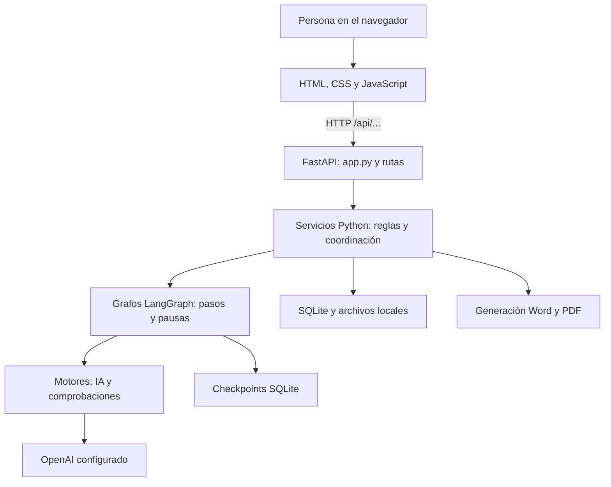

# Entender el proyecto y empezar a colaborar

**Entrega del 26 de octubre:** para instalar una copia nueva empieza por
[ENTREGA.md](ENTREGA.md). El flujo visible actual es Preanálisis → Identificación
→ Redacción → Borrador. Los mapas detallados siguientes conservan la inspección
fechada del 12 de octubre; sus resultados de pruebas corresponden a esa fecha.

Complemento para exposición académica: [arquitectura y estructura con diagramas](GUIA_VISUAL_PQRS_CLARO.md).

Revisión del 12 de octubre de 2026, sobre `pqrs-claro`, rama `master`, commit de referencia `7111276`. Esta guía explica el código inspeccionado y distingue el flujo habitual de sus alternativas de piloto. No es una certificación de operación institucional.

## 1. Qué estamos construyendo

Un asistente local para gestionar expedientes PQRS: recibir documentos, identificar las solicitudes que contienen, revisar su trámite, buscar soportes, preparar respuestas por solicitud y producir un oficio revisado en Word/PDF.

La unidad principal es el **expediente**. Un expediente puede contener varias **solicitudes**; cada solicitud puede tener sus propias fuentes, pendientes, respuesta y aprobación. El **oficio** reúne las respuestas aprobadas. Esta distinción explica buena parte del código.

Ejemplo ficticio: un PDF pide «informar los requisitos de prácticas» y «entregar el acta de un comité». Es un expediente con dos solicitudes. Encontrar el reglamento puede ayudar a responder la primera; no demuestra que el acta de la segunda esté disponible.

## 2. Qué carpeta estudiar

`AgenteO` es una carpeta que reúne proyectos y materiales; no es por sí misma un repositorio Git.

| Ubicación dentro de AgenteO | Función verificada |
| --- | --- |
| `pqrs-claro/` | Repositorio principal del recorrido actual, con arranque habitual en 8772. Es el punto de entrada para colaborar. |
| `pqrs-claro-fiaga/` | Worktree del mismo repositorio en la rama `codex/fiaga-revision-inicial`. Comparte historial Git, pero tiene archivos y datos locales propios. Su existencia no significa que deba usarse como versión principal. |
| `langgraph-pqrs/` | Implementación anterior, con su propio paquete `pqrs_langgraph` y arranque documentado en 8765. No coordina el flujo actual; existe una dependencia local de configuración porque la clave puede leerse desde su `.env.local`. |
| `n8n-workflows/` | Workflows y materiales de las etapas con n8n. El arranque actual no necesita ejecutar esos workflows. |
| `Documentos/` | Documentos y fuentes de trabajo. No equivale automáticamente a la biblioteca elegible de un expediente. |
| `output/`, `outputs/`, `analysis/`, temporales | Entregables, evidencia y materiales auxiliares; revisar su contenido antes de compartirlos. |

Dentro de `pqrs-claro/`:

```text
pqrs-claro/
├── src/pqrs_claro/       Código Python y carpeta static/
│   └── static/recorrido/ Interfaz principal: HTML, CSS, JavaScript
├── tests/               Pruebas Python, JavaScript y materiales de navegador
├── scripts/             Instalación, arranque, pruebas y utilidades
├── examples/            Casos y fuentes ficticias
├── docs/                Explicaciones, decisiones y validaciones fechadas
├── data/                Bases, originales y archivos persistentes locales
├── output/              Evidencias y recursos auxiliares locales
├── .runtime/            Dependencias instaladas en este equipo
├── pyproject.toml       Dependencias y configuración de herramientas
└── uv.lock              Versiones resueltas de dependencias
```

## 3. Cómo se conectan las piezas

La arquitectura puede describirse como una aplicación local modular: interfaz y API se sirven desde un proceso; los servicios coordinan tareas en segundo plano.



- **Interfaz:** muestra información, recoge decisiones y consulta el avance. Usa módulos JavaScript; esta interfaz no necesita React ni una compilación con npm.
- **FastAPI:** relaciona URLs con funciones Python. Una llamada HTTP es el mensaje que el navegador envía al servidor.
- **Pydantic:** define y valida la forma de los datos, por ejemplo los campos de una solicitud o de una decisión.
- **Servicios:** coordinan operaciones, verifican versiones y deciden si se puede avanzar.
- **LangGraph:** organiza secuencias y guarda puntos de continuación. Hay varios grafos pequeños; no todo el sistema vive en un único grafo.
- **Motores de IA:** interpretan, evalúan y redactan; las reglas de guardado, autorización del paso y aprobación siguen en el programa.
- **SQLite y archivos:** conservan expedientes, decisiones, originales y resultados.

El arranque habitual sigue esta cadena:

`scripts/start.ps1` → `scripts/start-unificado.ps1` → `unified_app.main()` → `create_unified_app()` → `app.create_app()`.

`start-recorrido.ps1` también delega en `start-unificado.ps1`. `unified_app.py` activa revisión inicial y bandeja de gestores; respeta el proveedor de clasificación configurado y escucha en `127.0.0.1:8772`. Leer solo los valores base de `Settings` puede confundir: su puerto base es 8770, pero el lanzador unificado los modifica.

## 4. Sigue un expediente de principio a fin

| Paso | Qué ocurre | Código para seguirlo |
| --- | --- | --- |
| 1. Recibir | Se conserva el PDF o se importa el correo y se crea/vincula el expediente. En la bandeja actual, recibir no inicia IA. | `app.py`, `storage.py`, `gmail_service.py`; interfaz `petition-upload.js`, `gmail-inbox.js` |
| 2. Tomar e iniciar | Se asigna un gestor; la acción posterior «Iniciar gestión» puede comenzar el análisis de un expediente nuevo. | `management.py`, `service.py`; interfaz `management-ui.js` |
| 3. Leer e identificar | Se extrae texto por página, se usa OCR si hace falta y se identifican solicitudes con referencias al original. | `workflow.py`, `extraction.py`, `identification.py`, `models.py` |
| 4. Revisar inicialmente | Se analiza el documento y sus solicitudes; se proponen tipos, observaciones y rutas. La persona revisa y confirma para continuar por la vía habitual. | `intake_service.py`, `intake_engine.py`, `intake_models.py`; interfaz `initial-review.js`, `initial-confirmation.js` |
| 5. Preparar | Se comprueba que el expediente puede continuar y se coordina fuentes → pendientes → borradores. | `preparation.py` |
| 6. Buscar y evaluar fuentes | Se filtra la biblioteca, se recuperan fragmentos candidatos y se evalúa qué respaldan realmente. | `source_library.py`, `source_retrieval.py`, `source_semantic.py`, `source_service.py`, `source_graph.py`, `source_assessment.py` |
| 7. Resolver pendientes | Se registran decisiones, evidencia y comprobaciones. Una solicitud con un pendiente bloqueante no obtiene automáticamente un borrador inicial. | `review_service.py`, `evidence_contract.py`, `document_decisions.py`, `source_verifications.py` |
| 8. Redactar | Cada solicitud elegible pasa por planificación, redacción, comprobación y, cuando corresponde, un ajuste acotado de citas. | `draft_service.py`, `draft_graph.py`, `draft_engine.py` |
| 9. Editar y aprobar | La persona edita, comprueba y aprueba una versión. Si cambian el contenido o dependencias relevantes, hay que actualizar la comprobación/aprobación. | `review_service.py`, `review_engine.py`, `review_graph.py`; interfaz `live-edit.js`, `live-document.js` |
| 10. Generar oficio | Se ensambla el contenido aprobado, se aplica el membrete y se producen archivos; Word de escritorio convierte a PDF. | `office_workspace.py`, `office_service.py`, `office_renderer.py`, `office_templates.py`, `office_word.py` |

Las rutas de interfaz de la tabla están bajo `src/pqrs_claro/static/recorrido/`; los módulos Python están bajo `src/pqrs_claro/`.

**Excepción implementada del piloto:** «Continuar sin revisión inicial» permite registrar una excepción por expediente y preparar sin aprobar ese análisis. `IntakeService.pilot_mode()` y `pilot_bypassed()` controlan su vigencia. Cambiar el original o la identificación la invalida. No elimina controles posteriores de fuentes, pendientes ni aprobación final. Ver [PILOTO_SIN_BLOQUEO_INICIAL.md](PILOTO_SIN_BLOQUEO_INICIAL.md).

**Dos estados diferentes:** el estado de gestión —asignado, en gestión, pendiente, finalizado— no es el estado del análisis ni la aprobación de respuestas. Exportar un PDF no finaliza automáticamente la gestión. Ver [BANDEJA_GESTORES.md](BANDEJA_GESTORES.md).

## 5. Cómo leer el código sin intentar memorizarlo

Las terminaciones orientan, aunque hay excepciones:

| Tipo de módulo | Pregunta que responde | Ejemplo |
| --- | --- | --- |
| `*_api.py` | ¿Qué petición HTTP recibe? | `review_api.py` |
| `*_service.py` | ¿Qué operación coordina y qué reglas exige? | `draft_service.py` |
| `*_graph.py` | ¿En qué orden suceden los pasos? | `draft_graph.py` |
| `*_engine.py` | ¿Cómo se evalúa o redacta? | `draft_engine.py` |
| `*_store.py` | ¿Cómo se guarda y recupera? | `review_store.py` |
| `*_models.py` | ¿Qué forma tienen los datos? | `intake_models.py` |

`intake_service.py` también contiene rutas; `source_library.py` combina biblioteca y persistencia; `workflow.py`, `service.py` y `storage.py` cubren la identificación inicial. Los sufijos son una orientación, no una separación perfecta.

Los cuatro grafos principales:

```text
workflow.py:     leer PDF → identificar → pausa para confirmar identificación
source_graph:   recuperar candidatos → evaluar soportes
draft_graph:    planificar → redactar → comprobar → ajuste/recomprobación si procede
review_graph:   comprobar revisión → esperar aprobación → registrar aprobación
```

La bandeja de gestores y la revisión inicial también tienen lógica fuera de estos grafos. `app.create_app()` es el mejor lugar para ver cómo se construyen y conectan todos los servicios.

Para seguir un clic concreto, abre `static/recorrido/initial-confirmation.js`, función `confirmAndPrepare()`: guarda primero la decisión y solo prepara si el resultado lo permite. En `live.js` puedes seguir las llamadas a `/initial-review/decision` y `/preparation`; en Python, sus rutas están en `intake_service.py` y `preparation.py`. Después sigue `PreparationService.start()` y `run()`.

Para comprender una llamada costosa, empieza por el servicio y luego llega al motor: así distingues la regla de negocio de la instrucción enviada al modelo.

## 6. Dónde están los datos y por qué se puede reanudar

| Archivo bajo `data/` | Responsabilidad |
| --- | --- |
| `expedientes.sqlite` | Expedientes y revisiones; también gestión, revisión inicial y preparación mediante tablas creadas por sus servicios. |
| `biblioteca.sqlite` | Catálogo, colecciones, relaciones y ejecuciones de análisis de fuentes. |
| `borradores.sqlite` | Resultados y ejecuciones de redacción. |
| `revisiones.sqlite` | Respuestas editadas, historial, aprobaciones y datos del área de trabajo del oficio. |
| `comprobaciones.sqlite` | Comprobaciones de fuentes y aplicaciones a expedientes. |
| `oficios.sqlite` | Historial de generaciones. |
| `checkpoints.sqlite`, `source_checkpoints.sqlite`, `draft_checkpoints.sqlite`, `review_checkpoints.sqlite` | Puntos de continuación de los grafos respectivos. |

También se conservan documentos originales y artefactos en disco. Los vectores semánticos tienen almacenamiento separado; consulta `source_semantic.py`.

Un registro de negocio dice «esta es la respuesta guardada»; un checkpoint dice «el proceso llegó hasta este paso». No cumplen la misma función. Además, algunos borradores de revisión se conservan en `localStorage` del navegador: tener ese borrador no equivale a una confirmación guardada en el servidor.

Las versiones, revisiones y huellas de entradas evitan sobrescribir cambios de otra ventana o reutilizar resultados desactualizados. `stale` significa que cambiaron dependencias relevantes. Los servicios marcan trabajos interrumpidos durante la recuperación al arrancar; la continuación puede requerir una acción de la persona.

## 7. Qué hace la IA y qué hace el equipo local

En la consulta de solo lectura al servicio de 8772 del 12/10/2026, `/api/config` reportó `gpt-6-luna`, clasificación `openai`, revisión inicial automática y gestión habilitadas. Es la configuración observada, no una garantía de que una llamada al proveedor vaya a tener éxito.

La identificación, evaluación y redacción usan OpenAI. Las llamadas inspeccionadas incluyen `store=False`; eso no convierte la inferencia en local: el contenido necesario se transmite al proveedor. En Windows, la biblioteca usa OCR local; la lectura de peticiones puede recurrir a OCR con OpenAI. La búsqueda semántica usa embeddings locales si está instalado el modelo configurado; conserva una alternativa textual cuando no está disponible.

La búsqueda recupera candidatos; la evaluación decide su pertinencia. `source_passages.py` materializa las citas por ubicación en el texto extraído. Una cita recuperada no certifica autenticidad, un reglamento no acredita por sí solo un hecho y un error de lectura no equivale a un documento inexistente.

Existen módulos y lanzadores JEV y laboratorios; su presencia no significa que estén activos en el recorrido habitual. El inicio unificado selecciona OpenAI. Tampoco se verificó aquí una integración operativa automática con OnBase/QFDocument. El flujo descrito consulta la biblioteca local incorporada.

## 8. Cómo está el código y dónde aportar

La inspección muestra separación funcional, contratos de datos, persistencia, control de versiones y pruebas con dependencias sustituibles desde `create_app()`. Esto permite probar el flujo con IA y conversión ficticias. También hay complejidad acumulada: varias interfaces, documentación de distintas fechas y módulos grandes como `source_assessment.py` y `draft_engine.py`. `live.js` concentra bastante coordinación y contiene líneas JavaScript densas. Esta es una orientación de mantenibilidad, no una auditoría completa.

| Aporte | Punto de entrada | Pruebas existentes útiles |
| --- | --- | --- |
| Bandeja y gestores | `management.py`, `static/recorrido/management-ui.js` | `test_management.py`, `test_case_lifecycle.py` |
| Revisión inicial | `intake_service.py`, `intake_engine.py`, `static/recorrido/initial-review.js` | `test_initial_review.py`, `test_fiaga_flow.py`, `test_pilot_review.py` |
| Búsqueda de documentos | `source_library.py`, `source_retrieval.py`, `source_context.py` | `test_hybrid_retrieval.py`, `test_document_content_retrieval.py` |
| Citas y respaldo | `source_passages.py`, `source_assessment.py`, `evidence_contract.py` | `test_source_passages.py`, `test_evidence_contract.py` |
| Preparación y pendientes | `preparation.py`, `draft_service.py`, `review_service.py` | `test_predraft_preparation.py`, `test_preparation.py` |
| Calidad de respuestas | `draft_engine.py`, `review_engine.py` | `test_draft_engine.py`, `test_review_engine.py` |
| Oficio y exportación | `office_workspace.py`, `office_renderer.py`, `office_word.py` | `test_office_workspace.py`, `test_office_renderer.py` |

Antes de cambiar una regla, seguir su recorrido completo: pantalla → API → servicio → persistencia → prueba. Para un primer aporte conviene elegir un comportamiento acotado y comprobarlo con un caso ficticio. Las optimizaciones recientes están documentadas en [OPTIMIZACION_RENDIMIENTO_20261009.md](OPTIMIZACION_RENDIMIENTO_20261009.md).

## 9. Preparar el entorno de un compañero

Requisitos documentados: Windows, `uv`, Python 3.12 y Word de escritorio para PDF. Los scripts ejecutan el Python administrado por `uv` y cargan dependencias de `.runtime`; no utilizan el ejecutable de `.venv` bloqueado en este equipo. Node es necesario para ejecutar las pruebas `.mjs`, no para servir la interfaz.

En una copia local preparada del repositorio:

```powershell
Set-Location C:\ruta\del\compañero\pqrs-claro
.\scripts\setup.ps1
.\scripts\test.ps1 tests/test_unified_app.py tests/test_fiaga_flow.py tests/test_management.py tests/test_pilot_review.py
```

Estos cuatro módulos usan datos temporales y dobles de IA/conversión. No sustituyen una prueba real de OpenAI, Gmail o Microsoft Word. El conjunto general se ejecuta con `scripts/test.ps1`; las comprobaciones `check_*live.py` son distintas y pueden llamar a IA real.

**Preparación de una instalación nueva:**

1. Configurar credenciales propias mediante las opciones de `.env.example` y `config.py`. No copiar las credenciales, tokens Gmail ni expedientes de Jorge. La búsqueda predeterminada de la clave en el proyecto hermano es una comodidad de este equipo, no una instalación portable.
2. El clon incluye recursos mínimos en `static/demo/` y el logo en `static/assets/`; ya no necesita copiar `output/`. La demo histórica de `output/ux-peticiones-20260910/` se reutiliza si existe localmente. Los documentos de esa demo permanecen fuera de la entrega; practicar con los casos ficticios de `examples/`.
3. Usar datos separados. Para una instancia de desarrollo en este mismo equipo, establecer `PQRS_CLARO_DATA_DIR` en un directorio nuevo y elegir otro puerto libre. Cambiar solo el puerto no aísla los datos.

Ejemplo de arranque de una copia ya preparada, con configuración autorizada y recursos presentes:

```powershell
$env:PQRS_CLARO_DATA_DIR = Join-Path $PWD 'output\qa\onboarding-local'
.\scripts\start-recorrido.ps1 -Port 8782
```

El comando mantiene el servidor en esa terminal; usar un puerto libre. Cargar un ejemplo no debe confundirse con activar una prueba sin IA: «Iniciar gestión» sí puede llamar al proveedor. Para practicar sin llamadas reales, comenzar por las pruebas automatizadas.

El selector de gestores es atribución local, no autenticación ni permisos institucionales. La colaboración entre desarrolladores es posible; una operación institucional multiusuario requiere trabajo adicional.

## 10. Sesión sugerida para ponerlo al día

1. **10 minutos:** explicar expediente, solicitud, soporte, pendiente, respuesta y oficio con el ejemplo de dos solicitudes.
2. **10 minutos:** recorrer el árbol y abrir `unified_app.py` y `app.create_app()`.
3. **15 minutos:** seguir `workflow.py`, revisión inicial y `PreparationService.run()`; identificar dónde se pausa y qué habilita continuar.
4. **15 minutos:** leer `tests/test_fiaga_flow.py` y ejecutar el conjunto acotado anterior. Observar cómo sustituye IA y conversión y cómo prueba invalidación de aprobaciones.
5. **10 minutos:** elegir un primer aporte, localizar su pantalla/API/servicio/prueba y acordar qué comportamiento debe conservar.

Al terminar, el compañero debería poder responder: ¿por qué recibir no inicia IA?, ¿dónde se guarda una decisión?, ¿qué habilita redactar?, ¿qué invalida una aprobación?, ¿qué diferencia hay entre terminar el análisis, aprobar y cerrar la gestión?, ¿cómo probar su cambio sin usar expedientes reales?

## 11. Alcance de esta revisión y lecturas siguientes

Se inspeccionaron código, configuración no secreta, estructura Git, documentación y pruebas. Se consultaron `/recorrido-status` y `/api/config` mediante GET; el servicio respondió como recorrido unificado en 8772. No se inició ni modificó un expediente real, no se conectó Gmail y no se invocó IA para elaborar esta guía.

El 12/10/2026 se ejecutó el comando acotado de la sección 9: **16 pruebas correctas en 66,99 segundos**, con una advertencia de deprecación de una dependencia de pruebas. Incluyó aplicación unificada, flujo FIAGA, gestión y excepción de piloto, usando datos temporales y dobles de IA/conversión. No se ejecutó la batería completa ni una prueba real de exportación con Word en esta revisión.

La guía [RECORRIDO_CODIGO.md](RECORRIDO_CODIGO.md) conserva explicaciones detalladas de fuentes, citas y exportación, pero su secuencia inicial y modelo predeterminado describen una etapa anterior. Para el comportamiento actual, combinarla con esta guía, [BANDEJA_GESTORES.md](BANDEJA_GESTORES.md), [UNIFICACION_FIAGA.md](UNIFICACION_FIAGA.md) y [PILOTO_SIN_BLOQUEO_INICIAL.md](PILOTO_SIN_BLOQUEO_INICIAL.md). Las cifras de validaciones históricas pertenecen a sus fechas; no equivalen a una ejecución nueva.
