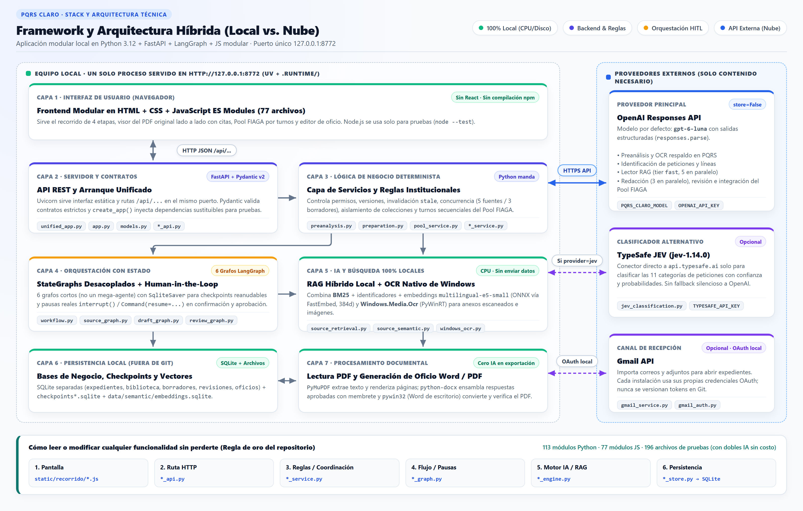
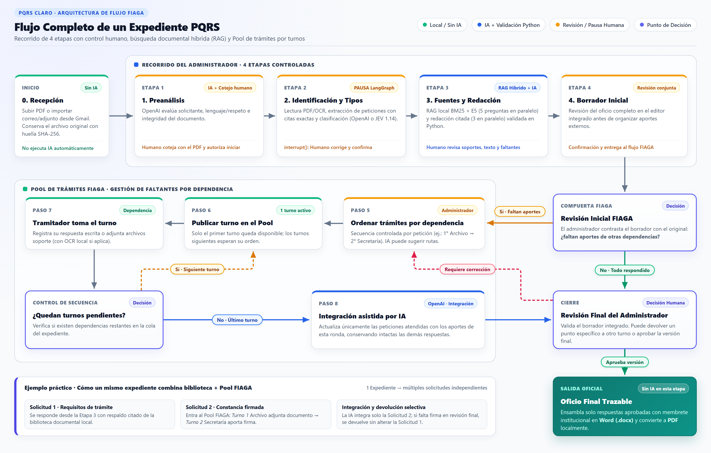
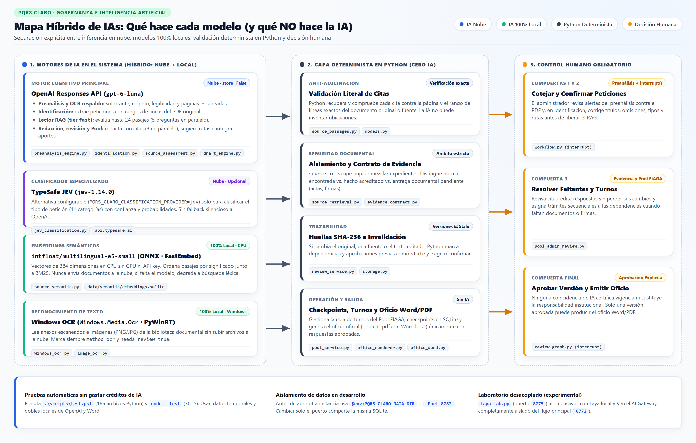
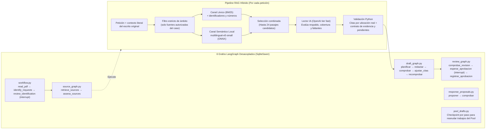
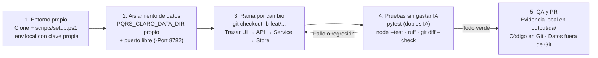

# PQRS Claro: arquitectura, framework, mapa de IAs y flujo FIAGA

Guía visual de incorporación actualizada al **25 de noviembre de 2026** sobre el estado real de `pqrs-claro`. Complementa la [guía de instalación y entrega](ENTREGA.md), el [manual para colaborar](../CONTRIBUTING.md) y el [recorrido de código](GUIA_PARA_ENTENDER_Y_COLABORAR.md).

> Los diagramas de esta página describen la arquitectura local del prototipo (`http://127.0.0.1:8772`) y su recorrido actual de **4 etapas + Pool FIAGA**. No representan un despliegue institucional multiusuario.

---

## 1. Framework y arquitectura híbrida (Local vs. Nube)

El sistema corre como una **aplicación local modular en un solo proceso** (Python 3.12 gestionado con `uv` en `.runtime/`): interfaz y API comparten el puerto `8772`, mientras las llamadas de IA se limitan al contenido necesario y los embeddings y el OCR de la biblioteca corren **100% en el equipo local**.



| Capa | Tecnología concreta | Responsabilidad principal |
| --- | --- | --- |
| **Interfaz** | HTML + CSS + JavaScript modular (`77` archivos ES Modules) | Recorrido de 4 etapas, visor del PDF original con citas, Pool FIAGA y editor de oficio. Sin React ni paso de compilación `npm`. |
| **API y contratos** | `FastAPI` + `Uvicorn` + `Pydantic v2` | Sirve UI y rutas `/api/...` en el puerto `8772`, valida contratos estrictos e inyecta dependencias en `app.create_app()`. |
| **Servicios Python** | Módulos `*_service.py`, `preparation.py`, `pool_service.py` | Reglas de negocio, control de versiones, invalidación `stale`, concurrencia (`5` fuentes / `3` borradores) y turnos del Pool. |
| **Orquestación** | `LangGraph` (`6` `StateGraph`) + `SqliteSaver` | Secuencias reanudables, checkpoints persistentes y pausas humanas explícitas con `interrupt()` / `Command(resume=...)`. |
| **RAG y OCR locales** | `BM25` + `FastEmbed` (`multilingual-e5-small` ONNX) + `Windows.Media.Ocr` | Búsqueda híbrida y lectura OCR de anexos/imágenes en CPU local, sin enviar documentos de la biblioteca a la nube. |
| **Persistencia** | SQLite (negocio separado de checkpoints y vectores) + disco | Conserva originales con SHA-256, expedientes, biblioteca, borradores, revisiones, comprobaciones y oficios bajo `data/`. |
| **Salida documental** | `PyMuPDF` + `python-docx` + `pywin32` (Word de escritorio) | Ensambla el oficio únicamente con respuestas aprobadas y verifica la conversión `.docx` → `.pdf`. **No invoca IA.** |

Cadena de arranque habitual:

`scripts/start.ps1` → `scripts/start-unificado.ps1` → `unified_app.main()` → `create_unified_app()` → `app.create_app()`.

---

## 2. Flujo completo de un expediente PQRS (4 Etapas + Pool FIAGA)

La unidad principal es el **expediente**. Un mismo expediente puede contener **varias solicitudes**, cada una con sus propias fuentes, pendientes, turnos en el Pool FIAGA y respuesta.



Distinciones clave al trabajar en el código:

- **Recibir no dispara IA:** cargar un PDF o importar un correo guarda el original (SHA-256) y abre el expediente sin consumir API.
- **Confirmar, aprobar y finalizar son hitos distintos:** confirmar identificación, aprobar una respuesta, generar el Word/PDF y cerrar la gestión son acciones separadas.
- **Un turno activo por expediente en el Pool:** el primer trámite queda disponible y los posteriores esperan en orden; devolver un punto en revisión final conserva las demás respuestas ya aprobadas.

---

## 3. Mapa de IAs: qué hace cada modelo y qué NO hace la IA

El proyecto separa explícitamente la inferencia de modelos (nube y local) de las reglas deterministas en Python y las decisiones humanas obligatorias.



| Motor / Componente | Ejecución | Tarea concreta | Módulos principales |
| --- | --- | --- | --- |
| **OpenAI `gpt-6-luna`** (`store=False`) | Nube (`Responses API`) | Preanálisis, OCR de respaldo en PQRS, identificación, clasificación por defecto, lector RAG (`fast`, 5 en paralelo), redacción (3 en paralelo), revisión, ruteo e integración del Pool. | `preanalysis_engine.py`, `identification.py`, `source_assessment.py`, `draft_engine.py`, `review_engine.py`, `pool_integration.py` |
| **TypeSafe `jev-1.14.0`** (opcional) | Nube (`api.typesafe.ai`) | Clasificador alternativo de tipos (11 categorías) activado con `PQRS_CLARO_CLASSIFICATION_PROVIDER=jev`. Sin fallback silencioso a OpenAI. | `jev_classification.py`, `jev_intake.py` |
| **`intfloat/multilingual-e5-small`** | **100% Local (CPU)** | Embeddings semánticos (384d, ONNX vía `FastEmbed`, SHA-256 verificado) para búsqueda híbrida; si falta el modelo, continúa con búsqueda léxica y aviso. | `source_semantic.py`, `semantic_preparation.py` |
| **Windows OCR (`OcrEngine`)** | **100% Local (WinRT)** | Reconocimiento de texto en PDFs escaneados e imágenes PNG/JPG cargados a la biblioteca. | `windows_ocr.py`, `windows_ocr_worker.py`, `image_ocr.py` |
| **Python determinista** | **100% Local (sin IA)** | Citas literales por página/línea, filtro de ámbito (`source_in_scope`), contrato de evidencia, invalidación `stale`, turnos del Pool y generación Word/PDF. | `source_passages.py`, `evidence_contract.py`, `pool_service.py`, `office_renderer.py`, `office_word.py` |

---

## 4. Cómo funciona LangGraph + RAG híbrido por dentro

En lugar de un único agente autónomo monolítico, el backend usa **6 grafos LangGraph pequeños y desacoplados**, cada uno con checkpoints en SQLite:



---

## 5. Estructura física y cómo navegar el código

El código Python vive en `src/pqrs_claro/` (`113` módulos) y la interfaz en `src/pqrs_claro/static/recorrido/` (`77` archivos JS).

```text
pqrs-claro/
├── pyproject.toml + uv.lock       Dependencias Python y versiones fijadas
├── .env.example                   Plantilla de configuración (sin claves)
├── scripts/
│   ├── setup.ps1                  Instala dependencias en .runtime/
│   ├── start.ps1                  Arranque unificado en 127.0.0.1:8772
│   ├── dev-python.ps1             Ejecuta Python usando .runtime/
│   └── test.ps1                   Ejecuta pytest con datos temporales y dobles IA
├── src/pqrs_claro/
│   ├── unified_app.py / app.py    Arranque unificado e inyección de dependencias
│   ├── config.py / models.py      Configuración y contratos Pydantic
│   ├── preanalysis*.py            Etapa 1: preanálisis y cotejo inicial
│   ├── workflow.py / extraction.py / identification.py   Etapa 2: lectura e identificación
│   ├── petition_classification.py / jev_classification.py / intake_*.py  Tipos y revisión inicial
│   ├── source_*.py / semantic_preparation.py / windows_ocr*.py   Biblioteca, OCR local y RAG híbrido
│   ├── preparation.py / draft_*.py / response_proposals.py       Etapa 3: redacción y comprobación
│   ├── review_*.py / evidence_contract.py                        Revisión humana y aprobación
│   ├── pool_*.py                  Flujo FIAGA: revisión inicial, turnos, ruteo e integración IA
│   ├── office_*.py                Etapa final: editor, Word (.docx) y conversión PDF
│   └── static/recorrido/          Interfaz HTML/CSS/JS modular (fiaga*.js, live*.js, preanalysis.js)
├── tests/                         166 archivos Python + 30 archivos JavaScript (.mjs)
├── examples/                      Peticiones y fuentes ficticias para practicar
└── docs/                          Guías, diagramas (docs/diagramas/) e informes fechados
```

Convención práctica para seguir cualquier funcionalidad de principio a fin:

`static/recorrido/*.js` (pantalla) → `*_api.py` (ruta HTTP) → `*_service.py` (reglas) → `*_graph.py` (pasos/pausas) → `*_engine.py` (IA/algoritmo) → `*_store.py` (SQLite).

---

## 6. Flujo de trabajo y colaboración del equipo



### Puesta en marcha rápida para nuevos integrantes

```powershell
# 1. Instalar runtime local (.runtime/) y crear .env.local propio
.\scripts\setup.ps1
Copy-Item .env.example .env.local

# 2. (Opcional) Descargar el modelo semántico local (~118 MB ONNX, sin API key)
.\scripts\dev-python.ps1 -m pqrs_claro.source_semantic --download

# 3. Verificar entorno sin gastar créditos de IA (usa datos temporales y dobles)
.\scripts\test.ps1 tests/test_unified_app.py tests/test_fiaga_flow.py tests/test_management.py tests/test_pilot_review.py

# 4. Iniciar con directorio de datos aislado y puerto libre
$env:PQRS_CLARO_DATA_DIR = Join-Path $PWD 'output/qa/mi-entorno'
.\scripts\start.ps1 -Port 8782
```

Reglas esenciales:

- **Código y datos se mantienen separados:** nunca subir a Git `data/`, `.env.local`, `.env.jev.local`, `output/`, `tmp/`, `.runtime/` ni tokens de Gmail.
- **Cambiar el puerto no aísla los datos:** define siempre `PQRS_CLARO_DATA_DIR` en PowerShell cuando ejecutes una segunda instancia local.
- **Primero pruebas automatizadas, luego pruebas en vivo:** las suites `scripts/test.ps1` y `node --test` corren sin API key ni Word; usa `examples/` o `check_*live.py` solo cuando necesites validar una integración real.

Para la instalación detallada y la transferencia de datos, consulta [ENTREGA.md](ENTREGA.md) y [CONTRIBUTING.md](../CONTRIBUTING.md).
