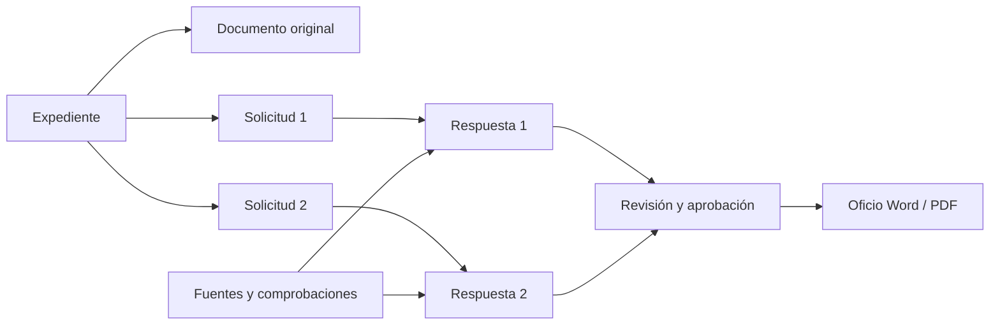
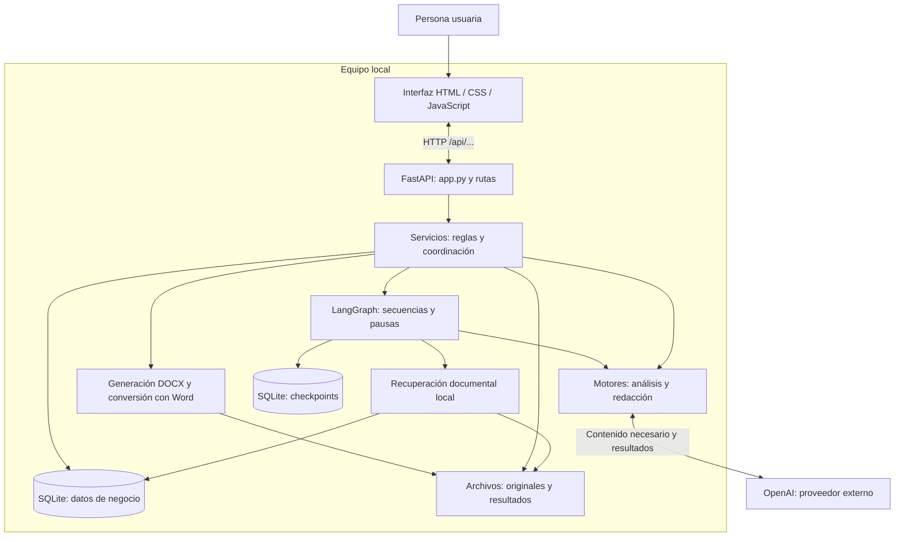
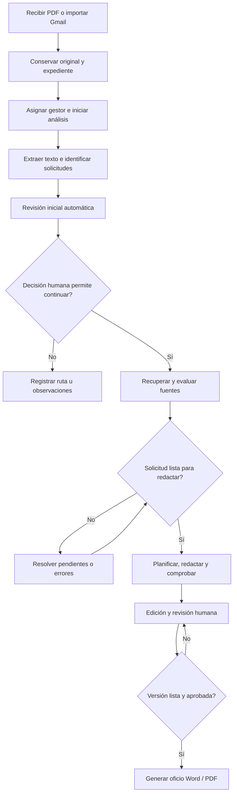
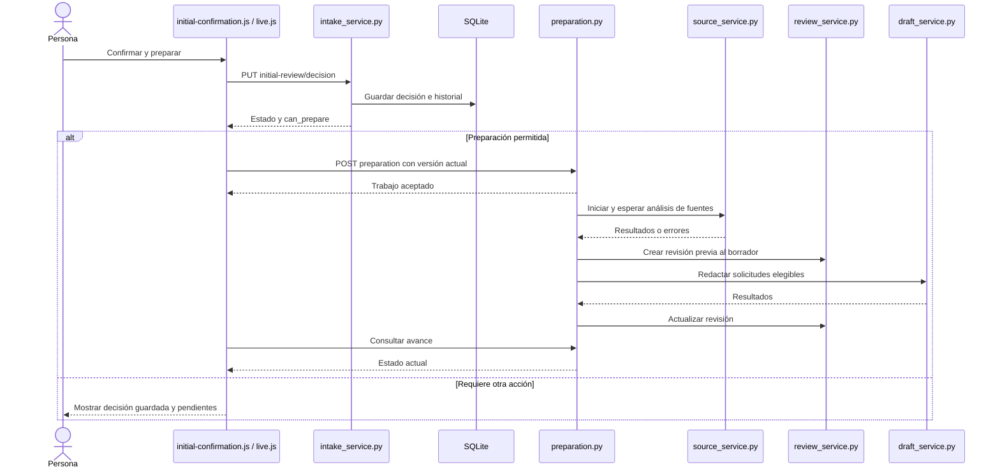
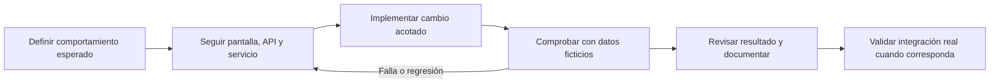

# PQRS Claro: arquitectura, proceso y estructura del código

Para el flujo de cuatro etapas y la instalación actual, consulta la
[guía de entrega](ENTREGA.md). Los diagramas siguientes documentan la inspección
fechada del 12 de octubre, con sus alternativas de piloto.

Material de explicación técnica y académica. Inspección del código: 12 de octubre de 2026. Los diagramas son esquemas de responsabilidades y flujos; no representan infraestructura institucional desplegada. El flujo de decisiones representa la vía habitual; la excepción explícita del piloto se señala aparte.

## 1. Objeto del sistema

La aplicación conserva expedientes, identifica solicitudes, recupera soportes documentales y prepara respuestas sujetas a revisión humana. El oficio reúne las respuestas aprobadas. Un expediente puede contener varias solicitudes, cada una con sus propias fuentes, pendientes y respuesta.



Los documentos que respaldan una solicitud no necesariamente respaldan otra. Una fuente normativa puede explicar un procedimiento sin acreditar que un hecho particular ocurrió.

## 2. Arquitectura general

La arquitectura actual es una aplicación local modular, servida en un proceso, con trabajadores en segundo plano. La interfaz y la API comparten el puerto 8772. OpenAI se consume como proveedor externo; la biblioteca y la persistencia son locales.



Las flechas resumen dependencias funcionales. No todos los servicios pasan por un grafo: la gestión de expedientes y la revisión inicial contienen coordinación propia.

| Componente | Responsabilidad |
| --- | --- |
| Interfaz | Recoger acciones, presentar resultados y consultar progreso. |
| API | Recibir solicitudes HTTP y dirigirlas a los servicios. |
| Servicios | Verificar condiciones, versiones y decisiones; coordinar procesamiento y guardado. |
| Grafos | Definir secuencias, bifurcaciones y puntos de continuación. |
| Motores | Ejecutar identificación, evaluación o redacción con validaciones. |
| Recuperación | Buscar fragmentos en fuentes habilitadas y preparar candidatos. |
| Persistencia | Conservar información, originales, historial y avance. |

## 3. Flujo de un expediente



El ciclo de resolución puede requerir aportar documentos y actualizar el análisis. La condición de redacción se comprueba por solicitud. La generación del oficio exige las condiciones de las respuestas incluidas.

Distinciones necesarias:

- Recibir no inicia por sí solo IA en la bandeja actual.
- Confirmar identificación, decidir una ruta, aprobar una respuesta y finalizar gestión son operaciones distintas.
- La excepción «Continuar sin revisión inicial» permite omitir ese bloqueo de forma explícita y registrada; no aprueba el análisis inicial ni elimina controles posteriores.
- Generar documentos no equivale a enviarlos ni a finalizar la gestión.

## 4. Estructura física del código

Árbol seleccionado, no inventario exhaustivo. Los módulos Python principales se encuentran directamente bajo `src/pqrs_claro/`; las agrupaciones por función de la sección siguiente son conceptuales.

```text
pqrs-claro/
├── pyproject.toml                 Dependencias y herramientas
├── uv.lock                        Versiones resueltas
├── scripts/
│   ├── setup.ps1                  Instalación del runtime
│   ├── start.ps1                  Entrada habitual
│   ├── start-recorrido.ps1        Entrada al recorrido
│   ├── start-unificado.ps1        Arranque de interfaz y API
│   ├── dev-python.ps1             Ejecución con el runtime del proyecto
│   └── test.ps1                   Ejecución de pruebas Python
├── src/pqrs_claro/
│   ├── unified_app.py             Configuración del arranque unificado
│   ├── app.py                     Construcción de aplicación y servicios
│   ├── config.py                  Configuración
│   ├── models.py                  Contratos de datos
│   ├── storage.py                 Persistencia de expedientes
│   ├── management.py              Asignación y estado de gestión
│   ├── service.py                 Coordinación de identificación
│   ├── workflow.py                Grafo de identificación
│   ├── extraction.py              Extracción del PDF
│   ├── identification.py          Identificación con IA
│   ├── intake_service.py          Revisión inicial y decisiones
│   ├── intake_engine.py           Evaluación inicial con IA
│   ├── preparation.py             Fuentes, pendientes y borradores
│   ├── source_library.py          Biblioteca documental
│   ├── source_retrieval.py        Recuperación de fragmentos
│   ├── source_assessment.py       Evaluación del respaldo
│   ├── draft_service.py           Coordinación de redacción
│   ├── draft_graph.py             Pasos de redacción y comprobación
│   ├── draft_engine.py            Motor de redacción
│   ├── review_service.py          Revisión, decisiones y aprobación
│   ├── office_service.py          Coordinación del oficio
│   ├── office_renderer.py         Construcción del documento
│   ├── office_word.py             Conversión local mediante Word
│   └── static/recorrido/
│       ├── index.html             Estructura de la interfaz
│       ├── app.js                 Coordinación general de la interfaz
│       ├── live.js                Interacción con expedientes reales
│       ├── initial-review.js      Presentación de revisión inicial
│       ├── initial-confirmation.js Confirmación y preparación
│       ├── live-pending.js        Acciones sobre pendientes
│       ├── live-edit.js           Edición de respuestas
│       └── live-document.js       Editor y generación del oficio
├── tests/                         Pruebas de reglas e integración
├── examples/                      Casos y fuentes ficticias
├── docs/                          Documentación
├── data/                          Bases y documentos locales
└── output/                        Recursos y evidencia auxiliar local
```

## 5. Organización funcional

| Función | Módulos principales |
| --- | --- |
| Recepción e identificación | `app.py`, `gmail_service.py`, `storage.py`, `service.py`, `workflow.py`, `extraction.py`, `identification.py` |
| Revisión inicial | `intake_models.py`, `intake_service.py`, `intake_engine.py`, `intake_cache.py` |
| Biblioteca y fuentes | `source_library.py`, `source_service.py`, `source_graph.py`, `source_retrieval.py`, `source_semantic.py`, `source_assessment.py`, `source_passages.py` |
| Preparación y redacción | `preparation.py`, `draft_service.py`, `draft_graph.py`, `draft_engine.py`, `draft_store.py` |
| Revisión y aprobación | `review_api.py`, `review_service.py`, `review_graph.py`, `review_engine.py`, `review_store.py`, `evidence_contract.py` |
| Oficio | `office_api.py`, `office_workspace.py`, `office_service.py`, `office_renderer.py`, `office_templates.py`, `office_word.py`, `office_store.py` |

Convención orientativa: `api` recibe, `service` coordina, `graph` ordena, `engine` procesa, `models` define estructuras y `store` conserva. Hay excepciones: por ejemplo, `intake_service.py` también define rutas HTTP.

## 6. Secuencia de una acción concreta

La confirmación inicial guarda primero la decisión; la preparación se solicita después si el servidor permite continuar.



Los caminos HTTP se muestran sin el prefijo `/api/cases/{case_id}` para facilitar la lectura. La secuencia omite reintentos y comprobaciones intermedias; no significa que la preparación sea una única llamada síncrona.

## 7. Método de trabajo para colaborar

El proyecto dispone de documentación, ejemplos ficticios y pruebas con motores sustituibles. El ciclo de trabajo para un aporte es:



Este diagrama describe un método de colaboración; no implica que una prueba local demuestre operación real de Gmail, OpenAI o Word. Durante la revisión anterior de esta conversación pasaron 16 pruebas seleccionadas con datos temporales y dobles de IA/conversión. No se repitieron para esta entrega documental.

Separar el directorio de datos para desarrollar. Usar otro puerto no aísla expedientes. Los gestores locales no equivalen a usuarios autenticados. Las aprobaciones corresponden a versiones y pueden invalidarse al cambiar contenido o soportes.

## 8. Orden sugerido para exponerlo

1. Explicar expediente, solicitudes y oficio con el primer diagrama.
2. Presentar arquitectura: interfaz, servidor, proveedor externo y persistencia.
3. Recorrer el flujo habitual y señalar decisiones humanas y pendientes.
4. Mostrar el árbol físico y las familias de módulos.
5. Seguir la confirmación inicial con el diagrama de secuencia.
6. Abrir `tests/test_fiaga_flow.py` y elegir un primer aporte acotado.

Para instalación, datos persistentes y límites adicionales, consultar [GUIA_PARA_ENTENDER_Y_COLABORAR.md](GUIA_PARA_ENTENDER_Y_COLABORAR.md).
